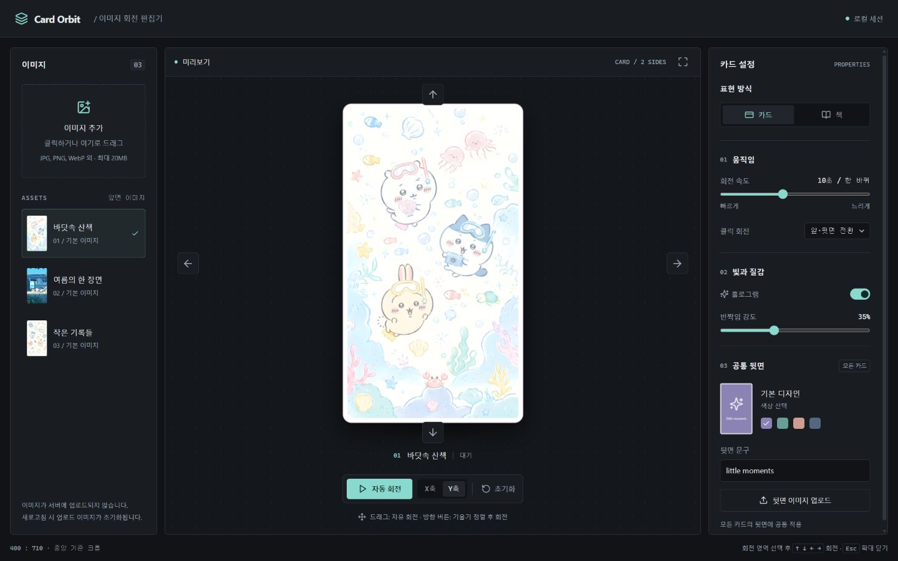

# Card Orbit

React + Vite + TypeScript + Bun으로 만든 브라우저 기반 카드 스튜디오입니다.

[배포 페이지에서 사용하기](https://liamyoon.github.io/card-orbit/)

[](https://liamyoon.github.io/card-orbit/)

## 실행

```sh
bun install
bun run dev
```

```sh
bun test
bun run build
bun run preview
```

## 사용법

- 첨부 이미지 세 장 중 하나를 선택하거나 앞면 이미지를 추가합니다.
- 카드를 누른 채 드래그하면 화면 기준 X/Y축으로 자유롭게 회전합니다. 터치도 지원합니다.
- 상하좌우 버튼 또는 카드 영역에 포커스한 뒤 방향키로 앞·뒷면을 전환하거나 한 바퀴 회전합니다. 버튼을 누르면 드래그로 생긴 모든 기울기와 대각선 회전(롤)을 먼저 초기화하고, 정렬된 면에서 선택한 단일 축으로만 회전합니다. 보이는 앞·뒷면과 가까운 상하 방향은 유지하므로 실제 책처럼 세로로 반 바퀴 돌리면 위아래도 함께 뒤집힙니다. 90도 정지는 제공하지 않습니다.
- 드래그는 각도 제한이나 자동 정렬 없이 자유롭게 회전하며, 클릭 회전 중에도 드래그를 시작하면 즉시 자유 회전으로 전환합니다.
- 자동 회전의 X/Y축과 한 바퀴 소요 시간을 선택할 수 있습니다. 자동 회전을 시작하거나 재생 중 축을 바꿀 때도 기울기를 먼저 초기화합니다. 일시정지는 현재 각도를 유지합니다.
- 공통 뒷면의 색상과 문구를 편집하거나 직접 만든 이미지를 업로드합니다.
- 홀로그램 효과와 반짝임 강도를 조절하고, 초기화로 앞면으로 돌아갑니다.
- **표현 방식 → 책**을 선택하면 앞·뒤 표지, 왼쪽 책등, 오른쪽·위·아래 페이지 단면을 가진 입체 책으로 표시합니다. 카드 모드로 다시 전환할 수도 있습니다.
- 책 두께는 12~60px로 조절합니다. 책등에는 뒷표지와 같은 색상·질감·업로드 이미지를 적용하며, 책등 제목을 별도로 입력할 수 있습니다. 제목을 비우면 뒷면 문구를 사용합니다.
- 책 모드에서도 자유 드래그와 X/Y축 자동 회전, 클릭 시 정확한 앞·뒷면 정렬이 동일하게 동작합니다.

업로드 파일은 서버로 전송하지 않으며 새로고침하면 사라집니다. 기본 이미지 세 장은 `public/images`에 포함되어 있습니다. 업로드 한도는 파일당 20MB이며 PNG/JPEG/WebP/GIF/AVIF를 지원합니다. 기본 이미지와 업로드 이미지 모두 카드 비율을 400:710으로 통일합니다. 앞면과 뒷면은 이미지 중앙을 기준으로 카드 영역을 가득 채우고 넘치는 부분을 잘라 표시합니다. 원본 파일은 변경하지 않습니다. 화면은 시스템 글꼴을 사용하며 외부 폰트를 요청하지 않습니다.

회전은 쿼터니언으로 누적해 이미 뒤집힌 상태에서도 드래그 방향이 화면 기준으로 유지됩니다. 자동 회전은 기본으로 꺼져 있습니다. 모션 감소 설정에서는 장식 전환을 생략합니다.

## 소스 구조

```text
src/
  main.tsx                 # React 진입점과 전역 SCSS 로딩
  App.tsx                  # 상태와 화면 컴포넌트 연결
  components/
    layout/                # 헤더와 상태 안내 푸터
    library/               # 이미지 업로드와 컬렉션 선택
    preview/               # 카드 양면, 책등·페이지 단면, 회전 영역, 재생 컨트롤
    settings/              # 카드/책 모드, 움직임, 효과, 공통 뒷면 설정
    ui/                    # 재사용 파일 입력, 섹션 제목, 상태 알림
  hooks/
    useCardRotation.ts     # 자동/클릭/드래그 회전과 포인터 처리
    useImageLibrary.ts     # 이미지 선택, 업로드, Object URL 수명 관리
  lib/
    rotation.ts            # DOM에 의존하지 않는 회전 계산
    faceTurn.ts            # 클릭 회전의 경로와 정확한 앞·뒷면 도착 자세
    imageFiles.ts          # 파일 검사, 이미지 디코딩
  data/cards.ts            # 기본 이미지, 방향, 업로드 제한 등 상수
  types/card.ts            # 공유 도메인 타입
  styles/
    main.scss              # SCSS 진입점; partial 적용 순서 정의
    _tokens.scss           # 전역 테마 값
    _breakpoints.scss      # 반응형 믹스인
    _responsive.scss       # 화면 크기별 레이아웃과 모션 감소 규칙
    _book.scss             # 책의 3D 면 배치와 페이지 질감
    _cover-theme.scss      # 뒷표지와 책등이 공유하는 질감·색상
    _*.scss                # 레이아웃, 카드, 방향 버튼, 설정 등 영역별 스타일
tests/                     # 회전 계산과 이미지 입력 제약 검사
```

화면 컴포넌트는 props로 상태와 동작을 전달받습니다. 회전 훅은 매 프레임 React를 다시 렌더링하지 않고 카드 요소의 transform만 갱신합니다. 이미지 훅은 뒷면 교체·기본 디자인 복원·언마운트 시 사용하지 않는 Object URL을 해제하며, 늦게 완료된 이전 뒷면 업로드는 무시합니다.

SCSS는 `@use`로 조합합니다. 호버·선택 상태는 해당 선택자 안에 중첩하고, 공통 화면 너비는 `_breakpoints.scss`에서 관리합니다. 공통 카드 비율과 런타임에 변하는 광택·뒷면 색상은 CSS 사용자 속성(`--ratio`, `--glow`, `--back-color` 등)을 유지합니다. 기존 캐스케이드를 보존하도록 `main.scss`에서 반응형 규칙을 마지막에 불러옵니다.

## 코드 포맷

```sh
bun run format        # TypeScript, TSX, SCSS와 설정 파일 정리
bun run format:check  # 포맷 변경 없이 검사
```

Sass는 Vite가 SCSS를 컴파일할 때 사용하며, 별도의 스타일 빌드 명령은 필요하지 않습니다.
